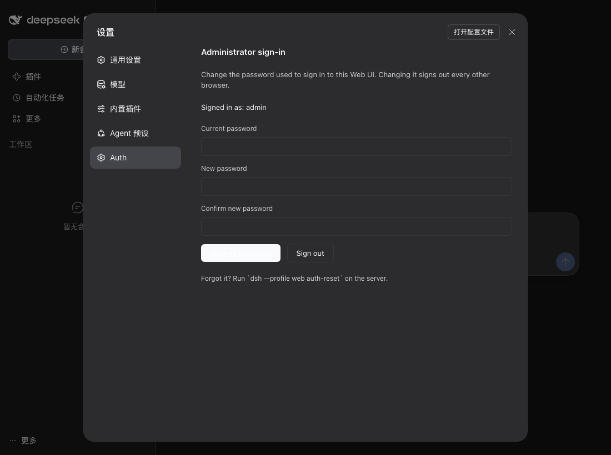

# dsh-public-access (`@timgong/dsh-public-access`)

[简体中文](README.md) | [English](README.en.md)

Public / LAN access plugin for DeepSeek Harness — `0.0.0.0` binding, `--public-url` / TLS, nginx, and username/password login.

> **Package**: `@timgong/dsh-public-access` (forked from JNan-QQ/dsh-public-access).
>
> **Current version**: `2.3.0-beta.1`, targeting **dsh `>=0.2.1-rc.2 <0.3.0`** (verified on 0.2.1-rc.5). Stay on plugin 1.3.0 for dsh 0.1.x.

## 📖 Overview

`@timgong/dsh-public-access` is a DeepSeek Harness plugin that exposes a local development instance to the public internet or a LAN while keeping a real login gate in front of it. It addresses four problems:

- **Network binding**: dsh 0.2.1 rejects wildcard addresses both in the CLI and in the `webserver` config schema; the plugin widens `WebServer.Config.host` in place on the boot path so `0.0.0.0` / `::` work again.
- **Authentication**: username/password login layered on top of dsh's native launch token / signed cookie, with sliding-renewal sessions (24h idle, 7d maximum).
- **Auth wiring**: in 0.2.1 `/api` goes through `connection.admit` instead of `requestRejection`; the plugin feeds the session into `admit` and `authorizeIndex`.
- **Frontend compatibility**: injects `__DSH_TRANSPORT__.ownsHost` and a `crypto.randomUUID` polyfill so settings persistence and RPC keep working on a non-loopback, plain-HTTP origin.

## ✨ Features

| Feature | Description |
|---------|-------------|
| 🌐 **Wildcard binding** | Custom `web-startup` + in-place widening of the boot-path `webserver` `host` schema, lifting the dsh 0.2.1 ban on `0.0.0.0` / `::` |
| 🔐 **Login** | Username/password login on top of dsh 0.2.1's native browser auth; `dsh_session` slides on activity: 24h idle, 7d maximum (both configurable) |
| 🌐 **Bilingual login** | The login page speaks Chinese and English: resolved from the URL parameter, cookie, `DSH_AUTH_LANG`, then `Accept-Language`, with an in-page switcher |
| 🛡️ **Trust fence** | Keeps dsh's Host/Origin fence; `--trusted-host` declares public IPs/domains, LAN addresses are derived automatically |
| 🖥️ **Frontend compatibility** | Injects `__DSH_TRANSPORT__.ownsHost` so public access gets loopback-level `isLoopback` behavior |
| 🔒 **crypto polyfill** | Fills in `crypto.randomUUID` on plain-HTTP public origins, preferring `getRandomValues` |
| 🚀 **Auto-detection** | `start.sh` detects the public IP and configures trusted-host / public-url; LAN addresses are derived from the NICs by `web-startup` |
| 🧹 **Revocable logout** | Logout clears `dsh_session` and every `dsh-auth-*` native cookie carried by the request |

Settings → Auth (live screenshot on dsh 0.2.1-rc.5; the Chinese build is [`docs/settings-panel.zh.png`](docs/settings-panel.zh.png)):



## ⬆️ Upgrading to 2.3.0-beta.1

> `2.3.0-beta.1` rebuilds the credential model and adds login throttling plus a settings panel on top of `2.2.0-beta`. It is **not merged into the `2.2.0-beta` release line**. Install it by explicit version (`@2.3.0-beta.1`) — pre-releases are never picked up by `@latest`.

### What changed (includes breaking changes)

**Credential model rewritten (breaking)**

- **No more `admin/admin`.** On first start without `DSH_AUTH_PASS`, the plugin **generates a random administrator password**, prints it, and writes it to `$DSH_HOME/dsh-public-access.initial-password` (`0600`, under `~/.dsh` by default). Change it under **Settings → Auth**; the plaintext file is deleted as soon as you do.
- **Credentials live in a file**: `$DSH_HOME/dsh-public-access.json` (`0600`, directory `0700`) holding the administrator name, a `scrypt` hash and a **random session signing secret**. The environment only seeds it on the very first start; once the file exists `DSH_AUTH_PASS` is ignored with a printed notice.
- **Password hashing is now `scrypt`** (N=16384, r=8, p=1, random 16-byte salt) instead of `SHA-256(salt‖password)`.
- **`DSH_AUTH_SALT` is gone** (setting it has no effect).
- **Everyone signs in once after upgrading**: the session secret is no longer derived from the password hash, so old `dsh_session` cookies cannot validate.
- **Stop setting `DSH_AUTH_PASS`**: environment variables are readable by other local users (`ps e`, `/proc/<pid>/environ`, unit files). It remains only as a one-time migration input.

**New**

- **Login throttling**: 5 failures from one client address lock it for 30 seconds; past 20 failures overall a global exponential backoff starts (doubling every 10 more failures, 5s → … → 5 min cap) with `429` + `Retry-After`. Genuine loopback callers are exempt from the global penalty.
- **Settings → Auth panel**: change the password and sign out. A successful change rotates the session secret, so **every other browser is signed out instantly** while the caller receives a fresh cookie. Copy follows the deployment language; styling uses only `--dsw-alias-*` theme tokens.
- **`dsh --profile web auth-reset`**: the recovery path for a forgotten password (hidden interactive prompt or `--password`), plus `--username`. It always rotates the session secret.
- **`DSH_AUTH_REQUIRE_SESSION=1`**: the plugin session becomes the **only** credential; the launch-token URL and dsh's native 30-day cookie stop working (off by default).
- **`DSH_AUTH_PROTECT_ROUTES=1`**: puts third-party webserver routes behind the plugin session (off by default). While off, startup lists the routes outside the gate.
- Logout is now `POST /_auth/logout`; `GET` still works for same-site requests so another page cannot force a sign-out.
- `--host` with a concrete IPv4/IPv6 literal is now gated on the same schema widening and fails loudly.

### From 2.1.x / 2.2.0-beta

```bash
dsh plugin --profile web add @timgong/dsh-public-access@2.3.0-beta.1
sudo systemctl restart dsh   # or restart your dsh --profile web process
```

1. If your unit file still carries `DSH_AUTH_PASS`, it is seeded into the credential file **once**; delete the variable afterwards (the plugin will say it is ignored). The seeded password is that variable's value.
2. If you never set `DSH_AUTH_PASS` (i.e. you were using `admin/admin`): the old password stops working immediately. Take the generated password from the startup log or `~/.dsh/dsh-public-access.initial-password`, then change it in the panel.
3. Every browser signs in once (the secret rotated).
4. To go back to a fixed password, use **Settings → Auth** or `dsh --profile web auth-reset`.

### From 1.3.0 / 2.0.0

The 0.1.x → 0.2.1 upstream auth entry point and behaviour both changed; 2.0.0 is a breaking release, and 2.1.1 renamed the package from `dsh-public-access` to **`@timgong/dsh-public-access`**, so remove the old package first:

1. upgrade dsh to `0.2.1-rc.2` or newer;
2. `dsh plugin --profile web remove dsh-public-access`;
3. `dsh plugin --profile web add @timgong/dsh-public-access@2.3.0-beta.1` (or `github:laoer/dsh-public-access` / a local path before it is on npm);
4. restart `dsh --profile web` and sign in with the generated password from the log or `~/.dsh/dsh-public-access.initial-password`;
5. confirm the startup log has no `webserver: ... wildcard ...` and that `/` redirects to `/_auth/login`.

Still on dsh 0.1.x? Stay on plugin 1.3.0; do not upgrade to 2.x.

## 📦 Installation

### Option 1: DSH plugin manager (recommended)

```bash
# When published to npm
dsh plugin --profile web add @timgong/dsh-public-access@2.3.0-beta.1

# From GitHub (pnpm reads the package.json in the repository)
dsh plugin --profile web add github:laoer/dsh-public-access

# Pin a commit for reproducibility
dsh plugin --profile web add 'github:laoer/dsh-public-access#<commit>'
```

### Option 2: Manual install / local development

```bash
# Clone the repository
git clone https://github.com/laoer/dsh-public-access.git
cd dsh-public-access

# Install dependencies
pnpm install

# Add it to the web profile as a link: dependency (recommended; the plugin
# resolves @deepseek-ai/dsh-host-webserver from the profile root, avoiding a
# second module instance)
dsh plugin --profile web add .
```

> When upgrading from the old package name, always run `dsh plugin --profile web remove dsh-public-access` first; `add` would otherwise leave the old bundle behind.
>
> Do not `npm link` the package globally and expect it to resolve dsh's internal packages. dsh anchors runtime resolution at the profile root, so `dsh plugin add .` is the supported development install.

## 🚀 Usage

### Quick start

```bash
./start.sh

# Or run dsh directly (the same core flags start.sh uses)
dsh --profile web --no-open --host 0.0.0.0 --port 3080
```

The first start prints a generated administrator password (and saves it to `~/.dsh/dsh-public-access.initial-password`):

```
[reverse-proxy-fix] No DSH_AUTH_PASS configured: generated an administrator password.
[reverse-proxy-fix]   username: admin
[reverse-proxy-fix]   password: 7fKq2mXcPvRt9aLsWb4N
[reverse-proxy-fix]   also saved in: /home/you/.dsh/dsh-public-access.initial-password
```

Open `http://<host-ip>:3080/` in a browser; the first visit redirects to `/_auth/login`. Sign in, then change the password under **Settings → Auth** (the plaintext file disappears at that point). LAN addresses are added to `trustedHosts` automatically from the NICs; declare public IPs / domains through `--trusted-host` or `DSH_TRUSTED_HOSTS`.

Forgot the password? `dsh --profile web auth-reset` (interactive) or `dsh --profile web auth-reset --password '<new>'`.

### Custom configuration

```bash
# Custom administrator name (only used when the account is created; change it
# later from the settings panel)
DSH_AUTH_USER=myuser ./start.sh

# Custom bind address / port
DSH_HOST=0.0.0.0 DSH_PORT=8080 ./start.sh

# Advertise a public domain or prefix-proxy root (used in startup logs,
# DSH_WEB_URL, and the agent runtime context)
DSH_PUBLIC_URL=https://app.example/ui/ ./start.sh

# Let dsh terminate TLS itself instead of nginx
DSH_TLS_CERT=/etc/ssl/app-chain.pem DSH_TLS_KEY=/etc/ssl/app-key.pem ./start.sh

# Extra trusted authorities (space-separated)
DSH_TRUSTED_HOSTS="app.example 203.0.113.10" ./start.sh
```

### Production deployment (nginx terminating TLS, recommended)

Let dsh listen on loopback only and put nginx in front for TLS and the public entry point. This avoids the wildcard bind entirely and shrinks the attack surface:

```bash
dsh --profile web --host 127.0.0.1 --port 3080 \
  --public-url https://app.example/ --trusted-host app.example
```

Use `--host 0.0.0.0` (or `::`) only when every local interface really must be reachable.

### systemd example

```bash
sudo tee /etc/systemd/system/dsh.service <<EOF
[Unit]
Description=DeepSeek Harness with Public Access
After=network.target

[Service]
Type=simple
User=your-user
WorkingDirectory=/path/to/dsh-public-access
# Do not put the password here: credentials live in
# ~/.dsh/dsh-public-access.json (0600). The first start generates a random
# password; change it from Settings -> Auth or with `auth-reset`.
Environment=DSH_AUTH_USER=admin
Environment=DSH_PORT=3080
Environment=DSH_PUBLIC_URL=https://app.example/
Environment=DSH_TRUSTED_HOSTS=app.example
ExecStart=/path/to/dsh-public-access/start.sh
Restart=always
RestartSec=5

[Install]
WantedBy=multi-user.target
EOF

sudo systemctl daemon-reload
sudo systemctl enable dsh
sudo systemctl start dsh
```

## ⚙️ Configuration

### Environment variables

| Variable | Default | Description |
|----------|---------|-------------|
| `DSH_AUTH_USER` | `admin` | Administrator name **used only when creating the account** on first start; the credential file wins afterwards |
| `DSH_AUTH_PASS` | unset | **Deprecated.** Seeds the credential file once, when it does not exist yet; ignored afterwards. Prefer leaving it unset and letting the plugin generate a password |
| `DSH_AUTH_FILE` | `$DSH_HOME/dsh-public-access.json` | Credential file path override (tests / multiple instances) |
| `DSH_AUTH_REQUIRE_SESSION` | off | `1` makes the plugin session the only credential: the launch-token URL and native browser cookie stop working |
| `DSH_AUTH_PROTECT_ROUTES` | off | `1` puts third-party webserver routes behind the plugin session too |
| `DSH_AUTH_IDLE_HOURS` | `24` | Sliding idle window (hours): the session dies after this long without a renewal |
| `DSH_AUTH_MAX_DAYS` | `7` | Absolute session lifetime (days) counted from login; `0` disables the cap |
| `DSH_AUTH_RENEW_MINUTES` | `5` | Renewal throttle: at most one `Set-Cookie` per N minutes |
| `DSH_AUTH_LANG` | browser | Login-page language: `zh-CN` or `en`; when unset, `Accept-Language` decides |
| `DSH_HOST` | `0.0.0.0` | Bind address `start.sh` passes to `--host` |
| `DSH_PORT` | `3080` | Listen port |
| `DSH_PUBLIC_URL` | empty | Public root URL passed to `--public-url` |
| `DSH_TRUSTED_HOSTS` | empty | Extra `--trusted-host` values, space-separated |
| `DSH_TLS_CERT` / `DSH_TLS_KEY` | empty | Passed to `--tls-cert` / `--tls-key`; must be set together |

### Command-line flags

| Flag | Description |
|------|-------------|
| `--host <host>` | Bind address: `127.0.0.1`, `0.0.0.0`, `::`, or a concrete IPv4/IPv6 literal |
| `--port <port>` | Listen port (0 lets the OS pick one) |
| `--no-open` | Do not open a browser automatically |
| `--trusted-host <authority>` | Add an extra trusted authority (repeatable; LAN addresses are derived automatically) |
| `--public-url <url>` | Advertised HTTP(S) root used for the printed/opened URL, `DSH_WEB_URL`, and the agent runtime context |
| `--tls-cert <file>` | PEM certificate chain; requires `--tls-key` |
| `--tls-key <file>` | Unencrypted PEM private key; requires `--tls-cert` |

> `--public-url` / `--tls-*` require dsh 0.2.1+. On older harnesses they fail loudly instead of being ignored.

## 🔧 Using with nginx

Let dsh listen on `127.0.0.1` and terminate TLS in nginx:

```bash
dsh --profile web --host 127.0.0.1 --port 3080 \
  --public-url https://your-domain.com/ --trusted-host your-domain.com
```

Key points:

- nginx must forward the real `Host` header (the default `proxy_set_header Host $host;` is enough). If it sends `127.0.0.1`, dsh treats the request as local.
- `--trusted-host` must include the authority in the browser's address bar; otherwise `/api` returns plain-text `forbidden`. That is dsh's Host fence, not a failed plugin login.
- For a path prefix (for example `https://app.example/ui/`), use `--public-url https://app.example/ui/` and have nginx strip `/ui/` before proxying. The plugin's login/logout/index redirects are relative, so they work behind a prefix.
- `X-Forwarded-Proto` is never trusted for auth decisions. To get `Secure` cookies, configure `--public-url https://...` or let dsh terminate TLS itself.

### Basic configuration

```nginx
server {
    listen 80;
    server_name your-domain.com;

    location / {
        proxy_pass http://127.0.0.1:3080;
        proxy_set_header Host $host;
        proxy_set_header X-Real-IP $remote_addr;
        proxy_set_header X-Forwarded-For $proxy_add_x_forwarded_for;
        proxy_set_header X-Forwarded-Proto $scheme;

        # WebSocket support
        proxy_http_version 1.1;
        proxy_set_header Upgrade $http_upgrade;
        proxy_set_header Connection "upgrade";
    }
}
```

### HTTPS configuration

```nginx
server {
    listen 443 ssl;
    server_name your-domain.com;

    ssl_certificate /path/to/cert.pem;
    ssl_certificate_key /path/to/key.pem;

    location / {
        proxy_pass http://127.0.0.1:3080;
        proxy_set_header Host $host;
        proxy_set_header X-Real-IP $remote_addr;
        proxy_set_header X-Forwarded-For $proxy_add_x_forwarded_for;
        proxy_set_header X-Forwarded-Proto $scheme;

        # WebSocket support
        proxy_http_version 1.1;
        proxy_set_header Upgrade $http_upgrade;
        proxy_set_header Connection "upgrade";
    }
}

server {
    listen 80;
    server_name your-domain.com;
    return 301 https://$server_name$request_uri;
}
```

## 🧭 How it works

### Three gates, two of which the plugin hooks

dsh 0.2.1 splits the web entry point by request type. The plugin feeds its session into two of the three paths and leaves the third to upstream:

| Request | dsh gate | What the plugin does |
|---|---|---|
| `/api` and API WebSocket upgrades | `connection.admit(req)` | Valid session → admitted as `browserPeer` (owner identity); otherwise hand the request back to upstream |
| `/` and `index.html` | `connection.authorizeIndex(req, res)` | Valid session → serve it and renew opportunistically on this load; otherwise `302 /_auth/login` |
| Static assets, plugin-owned routes, `/connect` | none upstream | Not wrapped by default (`DSH_AUTH_PROTECT_ROUTES=1` brings third-party routes in) |

```text
browser
  │  GET /              Cookie: dsh_session
  ▼
dsh webserver ──► connection.authorizeIndex ──► valid ─► render the SPA (renewing the cookie)
                                              └ invalid ─► 302 /_auth/login
  │  POST /api/...
  ▼
/api route ──► connection.admit ──► valid ─► browserPeer (owner)
                                  └ invalid ─► upstream native gate (launch-token cookie / 401)
  │  POST /_auth/login       (plugin-owned exact route — neither gate above applies)
  ▼
verify credentials → issue dsh_session → 302 ../
```

### Why "layer on top" rather than "take over"

The plugin never wraps `webServer.register` and never forges dsh's native `dsh-auth-*` cookie; it only uses the two admission methods upstream documents.

- **Gain**: when upstream reshapes its internals the plugin fails **loudly at startup** instead of "looks fine, gate silently gone".
- **Cost**: coverage is whatever upstream defines — a route another plugin registers directly on `webServer` is outside it. Startup lists those routes, and `DSH_AUTH_PROTECT_ROUTES=1` brings them behind the gate.

### Sessions and cookies

- `dsh_session` looks like `issuedAt.expiresAt.HMAC-SHA256`; the key lives in the credential file, so a restart keeps sessions alive while a password change signs everyone out.
- Sliding renewal: idle expiry after `DSH_AUTH_IDLE_HOURS` (24h), at most one renewal per `DSH_AUTH_RENEW_MINUTES` (5min) while active, absolute cap `DSH_AUTH_MAX_DAYS` (7d).
- Two renewal paths: the heartbeat injected into the index (only while the tab is visible **and** the user has produced input in that window, via `POST /_auth/renew`), and opportunistic renewal on every index load (covering JS-disabled clients).
- Attributes: `HttpOnly; SameSite=Lax`, plus `Secure` when TLS is direct or `--public-url` is `https:`.

### The two injected browser scripts

1. `globalThis.__DSH_TRANSPORT__.ownsHost = true` — gives non-loopback access the same `isLoopback` state as loopback; otherwise the settings mirror degrades to memory mode (the Models page then reports `settings are unavailable in this browser`).
2. A `crypto.randomUUID` polyfill — plain HTTP is a non-secure context and every RPC throws `TypeError` without it.

## 🔑 Credentials and sessions

### The credential file

`$DSH_HOME/dsh-public-access.json` (`~/.dsh/` by default, file `0600`, directory `0700`):

```json
{
  "version": 1,
  "username": "admin",
  "passwordHash": "scrypt$16384$8$1$<salt-hex>$<hash-hex>",
  "secret": "<32 bytes, hex>",
  "createdAt": 1793350000000,
  "updatedAt": 1793350000000
}
```

- `passwordHash`: `scrypt` (N=16384, r=8, p=1, random 16-byte salt). The cost parameters live inside the string, so raising them later does not break the format.
- `secret`: the session HMAC key. **A password change, a rename, or `auth-reset` rotates it** — that is what "changing the password signs every browser out" actually means.
- No plaintext password is stored, and reads are cached by `mtime+size` so each request does not re-parse the file.

### What happens on first start

| Situation | Result |
|---|---|
| Credential file exists | Used as-is; `DSH_AUTH_PASS` is ignored (with a notice) even if set |
| No file, `DSH_AUTH_PASS` set | That password seeds it **once** (migration path), then you are told to remove the variable |
| No file, no password | A random 20-character password is printed and written to `dsh-public-access.initial-password` (`0600`) |

### Changing and recovering

| Goal | How | Side effect |
|---|---|---|
| Change the password | Settings → Auth, or `auth-reset --password '<new>'` | Secret rotated; other browsers signed out; plaintext file removed |
| Rename the administrator | `auth-reset --username <name>` | Same as above |
| Forgot the password | `dsh --profile web auth-reset` (hidden interactive prompt) | Same as above |
| Start over | Delete the credential file and restart | A fresh random password |
| Several instances | Give each its own `DSH_HOME`, or point `DSH_AUTH_FILE` elsewhere | — |

### Login throttling

Five failures from one address lock it for 30 seconds; past 20 failures a global exponential backoff starts (doubling every 10 more, 5s → … → 5min cap), answered with `429` + `Retry-After`. Only the TCP peer address counts — `X-Forwarded-For` is never trusted — and genuine loopback callers are exempt from the global penalty so an attacker cannot lock the administrator out of their own machine.

> Behind a reverse proxy every client shares the proxy's address, which makes the per-address limit stricter than intended. Raise `DSH_AUTH_MAX_FAILURES` there, or throttle at the proxy instead.

## 🔒 Security

### Authentication (dsh 0.2.1 adaptation)

dsh 0.2.1 ships its own browser auth (a launch token exchanged for a 30-day signed cookie, required by both `/api` and the index, with `/api` also passing the Host/Origin fence first). This plugin layers its own session **on top**:

- **Wiring**: `connection.admit` (`/api` + API WS upgrades) and `connection.authorizeIndex` (index) — see [How it works](#-how-it-works).
- **Credentials and sessions**: `scrypt` at rest, random signing secret, password change signs everyone out — see [Credentials and sessions](#-credentials-and-sessions).
- **Trust fence**: unchanged. `--trusted-host` declares public IPs/domains; with `--host 0.0.0.0` the plugin derives LAN authorities from the NICs and `start.sh` probes the public IP. An undeclared Host gets 403 on `/api`.
- **Session-only mode**: with `DSH_AUTH_REQUIRE_SESSION=1` the launch token and the native 30-day cookie stop working, leaving only the revocable plugin session.
- **Logout**: clears `dsh_session` plus every `dsh-auth-*` native cookie on the request; a cross-site `GET` is refused.

### Security boundaries of wildcard binding

dsh 0.2.1 rejects `0.0.0.0` on the grounds that exposing every interface amplifies remote-code-execution risk. To keep the one-command public/LAN workflow, this plugin **widens the `WebServer.Config.host` schema in place on the boot path** and treats the login gate above as the compensating control. Keep in mind:

1. **This is not an upstream-supported configuration.** The schema shape may change on a dsh upgrade; when widening fails the plugin fails loudly instead of degrading silently.
2. **Login is not a substitute for network isolation.** When exposing to the internet, use HTTPS and a firewall/security group, and change the generated password.
3. **Third-party routes are outside the auth scope by default**: the plugin protects dsh's index and the `/api` routes managed by `connection`. Routes other plugins register directly on `webServer` follow their own policy — startup **lists** them so you can check, and `DSH_AUTH_PROTECT_ROUTES=1` brings them behind the gate (it wraps the harness's private route tables, hence opt-in). Install only plugins you trust.
4. **The plugin session is the revocable credential**: it never forges or replays dsh's native `dsh-auth-*` cookie; the native cookie remains a fallback entry point. `DSH_AUTH_REQUIRE_SESSION=1` removes that fallback entirely.

### Recommendations

1. **Change the generated password on first sign-in**: use Settings → Auth (do not put the password in an environment variable).
2. **Prefer nginx + loopback**: use `--host 0.0.0.0` only when multi-NIC direct access is truly needed.
3. **Use HTTPS**: terminate TLS in nginx, or configure `--tls-cert` / `--tls-key`.
4. **Restrict access**: limit source IPs with a firewall or security group.
5. **Keep it current**: keep the plugin and dsh versions in sync.

### Go-live checklist

Work through it in order; do not expose the port to an untrusted network with any item unchecked:

- [ ] **Replace the generated password**: Settings → Auth, then confirm `~/.dsh/dsh-public-access.initial-password` is gone
- [ ] **Bind as narrowly as possible**: a private interface if you can; if you use `0.0.0.0`, a firewall/security group is mandatory
- [ ] **TLS in place**: `--tls-cert`/`--tls-key` or nginx, then verify the cookie carries `Secure` (`curl -skD- -X POST …`)
- [ ] **trusted-host complete**: every public name/IP declared, otherwise `/api` answers 403
- [ ] **Read the uncovered-route list**: the startup `outside the plugin session gate` line should be empty or contain only plugins you trust
- [ ] **Firewall/security group** allows only the sources you need
- [ ] **`DSH_AUTH_REQUIRE_SESSION`**: set to `1` if the launch-token URL must not be an alternate entry
- [ ] **Reverse proxy**: forwards the real `Host` (otherwise the fence answers 403) and dsh listens on `127.0.0.1` only

## 🛠️ Troubleshooting

### Common issues

#### 1. The web UI is unreachable

```bash
# Is the service running?
ps aux | grep dsh

# Is the port listening?
netstat -tlnp | grep 3080

# Firewall rules
sudo ufw status
sudo iptables -L -n
```

#### 2. Login keeps bouncing back to the login page

```bash
# Check whether the browser blocks cookies
# Check that the system clock is accurate (session validation depends on timestamps)
date

# Clear browser cache and cookies
```

If you were working and got kicked out: sessions have an absolute cap, so after `DSH_AUTH_MAX_DAYS` (7 by default) from login you must sign in again; a tab that stays in the background or sees no input for longer than `DSH_AUTH_IDLE_HOURS` (24 by default) also expires.

#### 3. Forgot the password / want to rename the administrator

```bash
dsh --profile web auth-reset                        # hidden interactive prompt
dsh --profile web auth-reset --password '<new>'
dsh --profile web auth-reset --username alice

# Last resort: delete the credential file and restart to get a fresh random one
rm ~/.dsh/dsh-public-access.json
```

`auth-reset` rotates the session secret, so every signed-in browser must sign in again. It only touches the account — session data under `~/.dsh/sessions/` is untouched.

#### 3b. No generated password in the startup log

The password is generated only on the **first** start (when the credential file does not exist yet). If the file exists, check `~/.dsh/dsh-public-access.initial-password`; if that is gone too (you already changed the password), use `auth-reset`.

#### 3c. The log says "DSH_AUTH_PASS is set but ignored"

The credential file already exists, so the environment variable no longer applies — on purpose, so a stale unit file cannot revert a password set in the panel. Delete the variable.

#### 4. Startup fails with a webserver wildcard / `--host 0.0.0.0` error

The plugin could not widen the boot-path `WebServer.Config.host` (dsh version mismatch, or the boot path failed to resolve). Check:

```bash
dsh --profile web --dump-config | grep -A3 web-startup
```

Confirm that `web-startup` is disabled and `public-access-web-startup` is inserted. If it still fails:

- upgrade dsh to 0.2.1-rc.2;
- or bind a concrete NIC address: `--host 192.168.1.5`;
- or let dsh listen on `127.0.0.1` and expose it through nginx.

#### 5. The login POST returns 405 at `/_auth/_auth/login`

2.1.0 used the wrong relative path (`_auth/login`) in the login form, so `/_auth/login` resolved to `/_auth/_auth/login`. 2.1.1 switched to the sibling `login` and fixed the relative redirects after login and logout. After upgrading to 2.3.0-beta.1, force-reload the login page (or clear the cache):

```bash
dsh plugin --profile web remove dsh-public-access
dsh plugin --profile web add @timgong/dsh-public-access@2.3.0-beta.1
sudo systemctl restart dsh
```

#### 6. API requests return 401

```bash
# Make sure you are logged in and the session has not expired
# Check that the request carries the right cookie
curl -v -b "dsh_session=your-session" http://localhost:3080/api/status
```

If login succeeds but `/api` still returns 401, check that the plugin actually loaded and that `connection.admit` was patched; in dsh 0.2.1 `/api` no longer goes through `requestRejection`.

#### 7. API requests return 403 / plain-text forbidden

That is dsh's Host/Origin fence, not a failed plugin login. Add the authority from the browser's address bar to `--trusted-host` (or `DSH_TRUSTED_HOSTS`) and make sure the reverse proxy forwards the real `Host`. The response shape tells you which layer answered:

| Response | Origin | Fix |
|----------|--------|-----|
| 401 / redirect to `/_auth/login` | Plugin session invalid | Log in again |
| Plain-text `forbidden` | dsh Host fence | Add `--trusted-host` |
| 403 page on the login POST | Plugin rejected an untrusted Host | Add `--trusted-host` |

#### 8. WebSocket connections fail behind nginx

Make sure the nginx configuration carries WebSocket support:

```nginx
proxy_http_version 1.1;
proxy_set_header Upgrade $http_upgrade;
proxy_set_header Connection "upgrade";
```

### Logs

```bash
# dsh logs
journalctl -u dsh -f

# Or the process output directly
./start.sh 2>&1 | tee dsh.log
```

## 📁 Project structure

```
dsh-public-access/
├── src/
│   ├── *.ts                   # the only sources (tsc emits the sibling .js)
│   ├── reverse-proxy-fix.js   # main plugin (login/logout/renew/password routes + admit/authorizeIndex wiring + polyfills)
│   ├── auth.js                # session tokens (v3 format, sliding policy) and login-page rendering
│   ├── credentials.js         # credential file (scrypt, 0600, generated first-run password, auth-reset)
│   ├── rate-limit.js          # login throttling (per-address lockout + global exponential backoff)
│   ├── login-i18n.js          # login + panel copy, locale resolution (zh-CN / en)
│   ├── client/index.js        # browser half: Settings -> Auth panel (__ModuleLoader__ format, no React bundled)
│   ├── web-startup.js         # web startup config (host schema widening, new flags, trustedHosts derivation)
│   ├── webserver-schema.js    # boot-path webserver host schema widening + LAN authority derivation
│   └── public-url.js          # --public-url validation (same rules as stock)
├── docs/                      # screenshots and other static assets (shipped on npm)
├── test/                      # node:test unit tests (83)
├── tsconfig.json              # type-check config (noEmit)
├── tsconfig.build.json        # node-half build (emits src/*.js in place; excludes client)
├── tsconfig.client.json       # browser-half build (moduleDetection: legacy)
├── .github/workflows/ci.yml    # CI: typecheck + test + artifact freshness
├── cordis.patch.yml           # DSH plugin configuration patch
├── start.sh                   # launch script
├── package.json               # package metadata
├── README.md                  # Chinese documentation
└── README.en.md               # English documentation
```

## 🤝 Contributing

Contributions are welcome. The usual flow:

1. Fork the repository.
2. Create a feature branch: `git checkout -b feature/your-feature`.
3. Commit your changes: `git commit -m 'feat: add your feature'`.
4. Push the branch: `git push origin feature/your-feature`.
5. Open a pull request.

### Development setup

```bash
# Clone the repository
git clone https://github.com/laoer/dsh-public-access.git
cd dsh-public-access

# Install dependencies
pnpm install

# Type check + unit tests
npm run check

# Add it to the web profile as a link: dependency
dsh plugin --profile web add .
```

### Build (`src/*.ts` → `src/*.js`)

`src/*.ts` is the only source; `src/*.js` is build output. The dsh runtime, the `main`/`exports` fields in `package.json`, and the tests all load the `.js` files directly. The build is an **in-place tsc emit** (same directory, same basename), so the package layout and installation flows are unchanged and installing from git needs no build step.

```bash
npm run build             # node half: tsc -p tsconfig.build.json
                          # browser half: tsc -p tsconfig.client.json
npm run typecheck         # tsc -p tsconfig.json (noEmit, types only)
npm run check             # typecheck + test
npm run verify:artifacts  # build, then check src/*.js matches the committed version
                          # (prepublishOnly runs this automatically)
```

Rules:

- **Edit `.ts` only, never the `.js` by hand.** Run `npm run build` and commit the output alongside the source change.
- The `.js` files must stay committed: `dsh plugin add github:...` does not compile on install, so missing artifacts break plugin loading.
- tsc normalizes indentation to 4 spaces and adds semicolons; that is expected. Comments and JSDoc are preserved.
- `prepublishOnly` runs `verify:artifacts` + `test`, so a stale artifact blocks publishing.

> Why not tsup/esbuild: this project needs no bundling (every file is an independent ESM entry point), and esbuild drops comments by default — the JSDoc in `src/*.js` is the only documentation JS consumers get, so the build uses tsc, which preserves it.

**The browser half (`src/client/index.ts`) is the exception**: it must be a *classic* script in the `window.__ModuleLoader__.load({ id, factory })` envelope. Under `module: NodeNext` tsc treats a file without imports/exports as a module and appends `export {}` — a syntax error when the harness loads it with a `<script>` tag. It therefore compiles through its own `tsconfig.client.json` with `moduleDetection: legacy`, and `tsconfig.build.json` excludes it. Both artifacts are committed.

### Coding standards

- Use ES modules.
- Follow the existing style.
- Comment what is not obvious.
- Update the documentation.

## 📄 License

Released under the [Mulan Permissive Software License, Version 2](LICENSE) (MulanPSL-2.0).

## 🔗 Links

- **Repository**: https://github.com/laoer/dsh-public-access
- **DeepSeek Harness**: https://github.com/deepseek-ai/deepseek-harness
- **Issues**: https://github.com/laoer/dsh-public-access/issues

## 📞 Support

Questions and suggestions are welcome:

- Open an issue on the Gitee repository.
- Email the maintainer.

---

**Enjoy DeepSeek Harness!** 🎉

---

<p align="center">
  <a href="https://doseloop.bohely.cn" target="_blank" rel="noopener noreferrer">
    
  </a>
</p>
