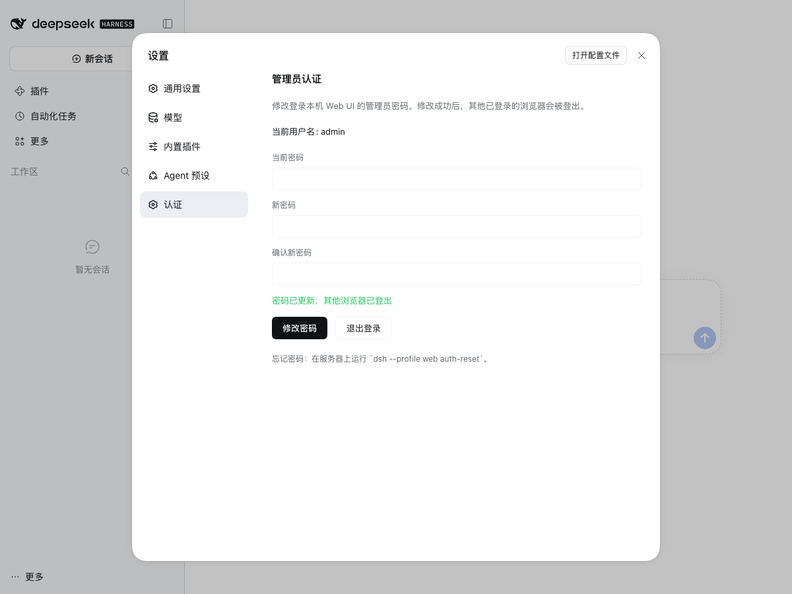

# dsh-public-access（`@timgong/dsh-public-access`）

[简体中文](README.md) | [English](README.en.md)

DeepSeek Harness 公网 / 局域网访问插件 — 支持 `0.0.0.0` 绑定、`--public-url` / TLS、nginx，以及用户名密码登录认证。

> **包名**：`@timgong/dsh-public-access`（fork 自 JNan-QQ/dsh-public-access）。
>
> **当前版本**：`2.3.0`（稳定版），适配 **dsh `>=0.2.1-rc.2 <0.3.0`**（实测基线 0.2.1-rc.5）。dsh 0.1.x 请继续使用插件 1.3.0。

## 📖 简介

`@timgong/dsh-public-access` 是一个 DeepSeek Harness 插件，用于将本地开发环境暴露到公网或局域网，同时提供安全的登录认证机制。该插件解决了以下核心问题：

- **网络绑定**：dsh 0.2.1 在 CLI 和 `webserver` 配置 schema 两处都拒绝通配地址；插件在 boot 路径上就地放宽 `WebServer.Config.host`，重新允许 `0.0.0.0` / `::`
- **安全认证**：在 dsh 原生启动令牌 / 签名 Cookie 之上叠加用户名密码登录，插件会话滑动续期（空闲 24 小时失效、最长 7 天）
- **凭据管理**：密码用 `scrypt` 存在 `$DSH_HOME/dsh-public-access.json`（`0600`），首次启动生成随机密码，改密在「设置 → 认证」里点两下完成，忘记密码用 `auth-reset` 恢复
- **鉴权接入**：0.2.1 的 `/api` 走 `connection.admit` 而不是 `requestRejection`，插件把会话接入 `admit` 与 `authorizeIndex`
- **前端兼容**：注入 `__DSH_TRANSPORT__.ownsHost` 与 `crypto.randomUUID` polyfill，保证非回环、明文 HTTP 访问下设置持久化与 RPC 正常

## ✨ 功能特性

| 功能 | 说明 |
|------|------|
| 🌐 **全接口绑定** | 自定义 `web-startup` + 就地放宽 boot 路径的 webserver `host` schema，解除 dsh 0.2.1 对 `0.0.0.0` / `::` 的限制 |
| 🔐 **登录认证** | 在 dsh 0.2.1 原生浏览器鉴权之上叠加用户名/密码登录；`dsh_session` 滑动续期：空闲 24 小时失效、最长 7 天（两者可配） |
| 🗝️ **凭据文件** | 密码用 `scrypt` 存进 `$DSH_HOME/dsh-public-access.json`（`0600`），首次启动生成随机密码并写入 `.initial-password`；**没有默认密码** |
| 🔧 **面板改密** | 设置面板「认证」页可改密码、退出登录；改密轮换会话密钥，其它浏览器立即登出 |
| 🚦 **登录限速** | 单地址 5 次失败锁 30 秒 + 全局指数退避（`429` / `Retry-After`），回环调用方不受全局惩罚 |
| 🧰 **`auth-reset`** | `dsh --profile web auth-reset` 重置密码/改名，并一次性吊销所有会话 |
| 🌐 **中英双语** | 登录页支持中文 / English：按 URL 参数、Cookie、`DSH_AUTH_LANG`、`Accept-Language` 依次判定，页面底部可切换 |
| 🛡️ **信任栅栏** | 保留 dsh 的 Host/Origin 栅栏；`--trusted-host` 声明公网 IP/域名，LAN 地址由插件自动推导 |
| 🖥️ **前端兼容** | 注入 `__DSH_TRANSPORT__.ownsHost`，使公网访问获得回环级 `isLoopback` 状态 |
| 🔒 **crypto polyfill** | 公网 HTTP 环境补齐 `crypto.randomUUID`，优先使用 `getRandomValues` |
| 🚀 **自动检测** | `start.sh` 自动探测公网 IP 并配置 trusted-host / public-url；LAN 地址由 `web-startup` 按网卡推导 |
| 🧹 **可撤销登出** | 登出同时清除 `dsh_session` 与请求中所有 `dsh-auth-*` 原生 Cookie |

设置面板 → 认证（dsh 0.2.1-rc.5 实机截图；英文版见 [`docs/settings-panel.en.png`](docs/settings-panel.en.png)）：



## ⬆️ 升级到 2.3.0

> `2.3.0` 是稳定版：在 `2.2.0-beta` 的基础上重做凭据模型、加上登录限速与「设置 → 认证」面板。`@latest` 即指向本版本，`npm ... add @timgong/dsh-public-access` 不带版本号即是它。

### 本版变更（含破坏性变更）

**凭据模型重做（breaking）**

- **不再有 `admin/admin` 默认密码**。首次启动时如果没有配置 `DSH_AUTH_PASS`，插件会**生成随机管理员密码**，打印到启动日志，并写入 `$DSH_HOME/dsh-public-access.initial-password`（`0600`，默认 `~/.dsh/` 下）。登录后到 **设置 → 认证** 改密，该明文文件会自动删除。
- **凭据存到文件**：`$DSH_HOME/dsh-public-access.json`（`0600`，目录 `0700`），含管理员名、`scrypt` 散列与**随机会话签名密钥**。环境变量只在**首次**启动、且文件不存在时用来播种；文件存在后 `DSH_AUTH_PASS` 会被忽略并打印提示。
- **密码散列升级为 `scrypt`**（N=16384, r=8, p=1，随机 16 字节盐），替换原来的 `SHA-256(salt‖password)`。
- **`DSH_AUTH_SALT` 废弃**，设了也不生效。
- **升级后需要重新登录一次**：会话密钥不再由「密码散列 + 盐」派生，旧 `dsh_session` 无法验证。一次性代价。
- **`DSH_AUTH_PASS` 建议不要再配置**：环境变量对同机其他用户可读（`ps e`、`/proc/<pid>/environ`、unit 文件）。保留它只为平滑迁移。

**新增能力**

- **登录限速**：单地址 5 次失败锁 30 秒；累计 20 次失败后全局指数退避（每再 10 次翻倍，5s→…→5min 上限），`429` + `Retry-After`；真回环调用方不受全局惩罚。
- **「设置 → 认证」面板**：改密码、退出登录；改密轮换会话密钥，**其他浏览器立即登出**，当前浏览器拿到新 Cookie 保持登录。文案跟随部署语言，样式只用 `--dsw-alias-*` 主题变量。
- **`dsh --profile web auth-reset`**：忘记密码的恢复路径，交互式（TTY 不回显）或 `--password`；`--username` 可改名。都会轮换会话密钥。
- **`DSH_AUTH_REQUIRE_SESSION=1`**：插件会话成为**唯一**凭据，启动令牌 URL 与 dsh 原生 30 天 Cookie 都不再放行（默认关闭）。
- **`DSH_AUTH_PROTECT_ROUTES=1`**：把第三方 webserver 路由也纳入鉴权（默认关闭）；不开时启动日志会列出闸门外的路由。
- 登出主推 `POST /_auth/logout`；`GET` 仅在非跨站请求时可用，避免被任意页面强制登出。
- `--host` 的具体 IPv4/IPv6 字面量也纳入 schema 拓宽门禁，失败时同样 fail loud。

### 从 2.1.x / 2.2.0-beta 升级

```bash
dsh plugin --profile web add @timgong/dsh-public-access@2.3.0
sudo systemctl restart dsh   # 或重启你的 dsh --profile web 进程
```

1. unit 文件里若还有 `DSH_AUTH_PASS`：它会被**一次性播种**进凭据文件，之后即可删除（插件会提示"已忽略"）。播种的密码就是该变量的值。
2. 如果从来没设过 `DSH_AUTH_PASS`（一直在用 `admin/admin`）：升级后**旧密码立即失效**，请从启动日志或 `~/.dsh/dsh-public-access.initial-password` 取随机密码登录，然后改密。
3. 所有浏览器需要重新登录一次（会话密钥换了）。
4. 想回到固定密码：登录后「设置 → 认证」，或 `dsh --profile web auth-reset`。

### 从 1.3.0 / 2.0.0 升级

0.1.x → 0.2.1 的上游鉴权入口和行为都变了，2.0.0 是 breaking release；2.1.1 同时把包名从 `dsh-public-access` 改为 **`@timgong/dsh-public-access`**，因此需要先移除旧包再安装新包：

1. 先把 dsh 升级到 `0.2.1-rc.2` 或更新；
2. 移除旧包：`dsh plugin --profile web remove dsh-public-access`；
3. 安装新包：`dsh plugin --profile web add @timgong/dsh-public-access@2.3.0`（未发布 npm 时用 `github:laoer/dsh-public-access` 或本地路径）；
4. 重启 `dsh --profile web`，从日志或 `~/.dsh/dsh-public-access.initial-password` 取随机密码登录；
5. 确认启动日志没有 `webserver: ... wildcard ...`，且访问 `/` 会跳转 `/_auth/login`。

如果仍在使用 dsh 0.1.x，请继续使用插件 1.3.0，不要升级到 2.x。

## 📦 安装

### 方式一：通过 DSH 插件管理器安装（推荐）

```bash
# 已发布到 npm 时（预发布请写显式版本号）
dsh plugin --profile web add @timgong/dsh-public-access@2.3.0

# 未发布 npm 时，从 GitHub 仓库安装（pnpm 读取仓库里的 package.json）
dsh plugin --profile web add github:laoer/dsh-public-access

# 固定 commit，便于复现
dsh plugin --profile web add 'github:laoer/dsh-public-access#<commit>'
```

### 方式二：手动安装 / 本地开发

```bash
# 克隆仓库
git clone https://github.com/laoer/dsh-public-access.git
cd dsh-public-access

# 安装依赖
pnpm install

# 以 link: 方式装进 web profile（推荐；插件会从 profile 根解析
# @deepseek-ai/dsh-host-webserver，避免命中第二份模块实例）
dsh plugin --profile web add .
```

> 从旧包升级时，务必先 `dsh plugin --profile web remove dsh-public-access`；新旧包名不同，直接 add 会留下旧 bundle。
>
> 不要用 `npm link` 直接全局链接后期待它自动解析 dsh 内部包；dsh 的 runtime resolution 以 profile 根为锚点，`dsh plugin add .` 才是受支持的开发安装方式。

## 🚀 使用方法

### 快速启动

```bash
./start.sh

# 等价于 start.sh 的核心参数
dsh --profile web --no-open --host 0.0.0.0 --port 3080
```

首次启动会在日志里打印一段随机管理员密码（同时写入 `~/.dsh/dsh-public-access.initial-password`），例如：

```
[reverse-proxy-fix] No DSH_AUTH_PASS configured: generated an administrator password.
[reverse-proxy-fix]   username: admin
[reverse-proxy-fix]   password: 7fKq2mXcPvRt9aLsWb4N
[reverse-proxy-fix]   also saved in: /home/you/.dsh/dsh-public-access.initial-password
```

浏览器访问 `http://<主机IP>:3080/`，首次会跳转 `/_auth/login`，用上面的账号登录，然后到 **设置 → 认证** 改密（改完明文文件会被删除）。局域网地址由插件按网卡自动加入 trustedHosts；公网 IP / 域名请通过 `--trusted-host` 或 `DSH_TRUSTED_HOSTS` 声明。

忘记密码时：`dsh --profile web auth-reset`（交互式），或 `dsh --profile web auth-reset --password '<新密码>'`。

### 自定义配置启动

```bash
# 自定义管理员名（只在首次建账时生效；之后用设置面板改）
DSH_AUTH_USER=myuser ./start.sh

# 自定义绑定地址 / 端口
DSH_HOST=0.0.0.0 DSH_PORT=8080 ./start.sh

# 广告一个公网域名或前缀代理地址（同时用于启动日志、DSH_WEB_URL、Agent 上下文）
DSH_PUBLIC_URL=https://app.example/ui/ ./start.sh

# dsh 直接终止 TLS（而不是由 nginx 终止）
DSH_TLS_CERT=/etc/ssl/app-chain.pem DSH_TLS_KEY=/etc/ssl/app-key.pem ./start.sh

# 追加可信 authority（空格分隔多个）
DSH_TRUSTED_HOSTS="app.example 203.0.113.10" ./start.sh
```

### 生产环境部署（推荐：nginx 终止 TLS）

推荐让 dsh 只监听 loopback，由 nginx 做 TLS 与公网入口；这样不需要放宽通配绑定，攻击面更小：

```bash
dsh --profile web --host 127.0.0.1 --port 3080 \
  --public-url https://app.example/ --trusted-host app.example
```

只有确实需要“本机所有网卡直连”时才使用 `--host 0.0.0.0`（或 `::`）。

### systemd 示例

```bash
sudo tee /etc/systemd/system/dsh.service <<EOF
[Unit]
Description=DeepSeek Harness with Public Access
After=network.target

[Service]
Type=simple
User=your-user
WorkingDirectory=/path/to/dsh-public-access
# 不要在这里写密码：凭据在 ~/.dsh/dsh-public-access.json（0600），
# 首次启动生成随机密码并打印，之后用「设置 → 认证」或 auth-reset 修改。
Environment=DSH_AUTH_USER=admin
Environment=DSH_PORT=3080
Environment=DSH_PUBLIC_URL=https://app.example/
Environment=DSH_TRUSTED_HOSTS=app.example
ExecStart=/path/to/dsh-public-access/start.sh
Restart=always
RestartSec=5

[Install]
WantedBy=multi-user.target
EOF

sudo systemctl daemon-reload
sudo systemctl enable dsh
sudo systemctl start dsh
```

## ⚙️ 配置选项

### 环境变量

| 变量 | 默认值 | 说明 |
|------|--------|------|
| `DSH_AUTH_USER` | `admin` | **仅在首次启动建账时**使用的管理员名；之后以凭据文件为准 |
| `DSH_AUTH_PASS` | 未设置 | **已废弃**。仅在凭据文件还不存在时用来一次性播种密码；之后会被忽略。推荐完全不要设置，让插件生成随机密码 |
| `DSH_AUTH_FILE` | `$DSH_HOME/dsh-public-access.json` | 凭据文件路径覆盖（测试/多实例用） |
| `DSH_AUTH_REQUIRE_SESSION` | 关闭 | 设为 `1` 时插件会话是唯一凭据：启动令牌 URL 与原生浏览器 Cookie 都不再放行 |
| `DSH_AUTH_PROTECT_ROUTES` | 关闭 | 设为 `1` 时把第三方插件注册的 webserver 路由也纳入插件会话闸门 |
| `DSH_AUTH_IDLE_HOURS` | `24` | 滑动会话的空闲窗口（小时）：这么久没有续期即失效 |
| `DSH_AUTH_MAX_DAYS` | `7` | 会话绝对上限（天），从登录时刻算起；`0` 表示不设上限 |
| `DSH_AUTH_RENEW_MINUTES` | `5` | 续期节流：最多每 N 分钟写一次 `Set-Cookie` |
| `DSH_AUTH_LANG` | 跟随浏览器 | 登录页语言：`zh-CN` 或 `en`；不设置时按 `Accept-Language` 自动选择 |
| `DSH_HOST` | `0.0.0.0` | `start.sh` 传给 `--host` 的绑定地址 |
| `DSH_PORT` | `3080` | 监听端口 |
| `DSH_PUBLIC_URL` | 空 | 传给 `--public-url` 的对外根 URL |
| `DSH_TRUSTED_HOSTS` | 空 | 额外 `--trusted-host`，空格分隔 |
| `DSH_TLS_CERT` / `DSH_TLS_KEY` | 空 | 传给 `--tls-cert` / `--tls-key`，必须成对 |

### 命令行参数

| 参数 | 说明 |
|------|------|
| `--host <host>` | 绑定地址：`127.0.0.1`、`0.0.0.0`、`::`，或具体 IPv4/IPv6 字面量 |
| `--port <port>` | 指定监听端口（0 表示自动选择） |
| `--no-open` | 不自动打开浏览器 |
| `--trusted-host <authority>` | 添加额外的 trusted-host（可重复使用；LAN 地址会自动推导） |
| `--public-url <url>` | 对外公告的 HTTP(S) 根；用于打印/打开 URL、`DSH_WEB_URL` 与 Agent 运行时上下文 |
| `--tls-cert <file>` | PEM 证书链；必须与 `--tls-key` 同时使用 |
| `--tls-key <file>` | 未加密 PEM 私钥；必须与 `--tls-cert` 同时使用 |
| `auth-reset [--password <pw>] [--username <name>]` | 子命令：重置管理员密码/改名，并让所有已登录会话失效 |

> `--public-url` / `--tls-*` 需要 dsh 0.2.1+。在更旧的 dsh 上会直接报错，而不是静默忽略。

## 🔧 与 nginx 配合使用

推荐让 dsh 只监听 `127.0.0.1`，由 nginx 终止 TLS：

```bash
dsh --profile web --host 127.0.0.1 --port 3080 \
  --public-url https://your-domain.com/ --trusted-host your-domain.com
```

要点：

- nginx 必须转发真实 `Host`（默认的 `proxy_set_header Host $host;` 即可）；写成 `127.0.0.1` 会被 dsh 当作本机请求。
- `--trusted-host` 必须包含浏览器地址栏里的域名；否则 `/api` 会返回纯文本 `forbidden`，这是 dsh 的 Host 栅栏，不是插件登录失败。
- 如果使用路径前缀（例如 `https://app.example/ui/`），用 `--public-url https://app.example/ui/`，并让 nginx 剥掉 `/ui/` 前缀转给 dsh；插件的登录/登出/index 跳转都使用相对路径，可以正常工作。
- `X-Forwarded-Proto` 不作为鉴权依据；需要 `Secure` Cookie 时请配置 `--public-url https://...` 或让 dsh 直接终止 TLS。

### 基本配置

```nginx
server {
    listen 80;
    server_name your-domain.com;

    location / {
        proxy_pass http://127.0.0.1:3080;
        proxy_set_header Host $host;
        proxy_set_header X-Real-IP $remote_addr;
        proxy_set_header X-Forwarded-For $proxy_add_x_forwarded_for;
        proxy_set_header X-Forwarded-Proto $scheme;
        
        # WebSocket 支持
        proxy_http_version 1.1;
        proxy_set_header Upgrade $http_upgrade;
        proxy_set_header Connection "upgrade";
    }
}
```

### HTTPS 配置

```nginx
server {
    listen 443 ssl;
    server_name your-domain.com;

    ssl_certificate /path/to/cert.pem;
    ssl_certificate_key /path/to/key.pem;

    location / {
        proxy_pass http://127.0.0.1:3080;
        proxy_set_header Host $host;
        proxy_set_header X-Real-IP $remote_addr;
        proxy_set_header X-Forwarded-For $proxy_add_x_forwarded_for;
        proxy_set_header X-Forwarded-Proto $scheme;
        
        # WebSocket 支持
        proxy_http_version 1.1;
        proxy_set_header Upgrade $http_upgrade;
        proxy_set_header Connection "upgrade";
    }
}

server {
    listen 80;
    server_name your-domain.com;
    return 301 https://$server_name$request_uri;
}
```

## 🧭 工作原理

### 三道闸门，插件只接两道

dsh 0.2.1 的 Web 入口按请求类型分成三条路，插件把会话接入其中两条，第三条原样留给上游：

| 请求 | dsh 的闸门 | 插件的行为 |
|---|---|---|
| `/api` 与 API WebSocket 升级 | `connection.admit(req)` | 会话有效 → 以 `browserPeer`（owner 身份）准入；无效 → 交回上游原生判定 |
| `/` 与 `index.html` | `connection.authorizeIndex(req, res)` | 会话有效 → 放行，并在这次加载里顺带续期；无效 → `302 /_auth/login` |
| 静态资源、插件自有路由、`/connect` | 上游不设防 | 默认不介入（`DSH_AUTH_PROTECT_ROUTES=1` 可把第三方路由也包住） |

```text
浏览器
  │  GET /              Cookie: dsh_session
  ▼
dsh webserver ──► connection.authorizeIndex ──► 有效 ─► 渲染 SPA（并续期 Cookie）
                                              └─ 无效 ─► 302 /_auth/login
  │  POST /api/...
  ▼
/api 路由 ──► connection.admit ──► 有效 ─► browserPeer（owner）
                                  └ 无效 ─► 上游原生判定（启动令牌 Cookie / 401）
  │  POST /_auth/login       （插件自有 exact 路由，不经过上面两道闸门）
  ▼
校验用户名密码 → 下发 dsh_session → 302 ../
```

### 为什么是"叠加"而不是"接管"

插件不包 `webServer.register`、不伪造 dsh 原生 `dsh-auth-*` Cookie，只接上游文档化的两个准入方法。

- **收益**：上游改内部结构时，插件坏的方式是**启动抛错**，不会"看起来正常但闸门没了"。
- **代价**：覆盖面由上游定义决定——第三方插件自己注册在 `webServer` 上的路由不在范围内。启动日志会列出这些路由，`DSH_AUTH_PROTECT_ROUTES=1` 可把它们也纳入。

### 会话与 Cookie

- `dsh_session` 形如 `issuedAt.expiresAt.HMAC-SHA256`，密钥存在凭据文件里 → 重启不掉线、改密即全端下线。
- 滑动续期：空闲 `DSH_AUTH_IDLE_HOURS`（默认 24h）失效；活跃时最多每 `DSH_AUTH_RENEW_MINUTES`（默认 5min）续一次；硬上限 `DSH_AUTH_MAX_DAYS`（默认 7d）。
- 续期两条路径：注入 index 的心跳（仅标签页可见**且**本轮有键盘/指针输入时触发 `POST /_auth/renew`），以及每次 index 加载时在闸门里顺带续期（覆盖禁用 JS 的客户端）。
- Cookie 属性：`HttpOnly; SameSite=Lax`；TLS 直连或 `--public-url https://…` 时追加 `Secure`。

### 前端注入的两段脚本

1. `globalThis.__DSH_TRANSPORT__.ownsHost = true` —— 让非回环访问拿到与回环一致的 `isLoopback`，否则设置面板的持久化会退化成内存模式（Models 页报 `settings are unavailable in this browser`）。
2. `crypto.randomUUID` polyfill —— 明文 HTTP 属于非安全上下文，缺这个方法会让每个 RPC 请求抛 `TypeError`。

## 🔑 认证与凭据

### 凭据文件

`$DSH_HOME/dsh-public-access.json`（默认 `~/.dsh/`，文件 `0600`、目录 `0700`）：

```json
{
  "version": 1,
  "username": "admin",
  "passwordHash": "scrypt$16384$8$1$<salt-hex>$<hash-hex>",
  "secret": "<32 字节十六进制>",
  "createdAt": 1793350000000,
  "updatedAt": 1793350000000
}
```

- `passwordHash`：`scrypt`（N=16384, r=8, p=1，随机 16 字节盐）。参数写在字符串里，将来调高成本不会破坏格式。
- `secret`：会话 HMAC 密钥。**改密 / 改名 / `auth-reset` 都会轮换它**——这就是"改密 = 所有浏览器下线"的实现方式。
- 文件里**没有明文密码**；读取按 `mtime+size` 缓存，所以每个请求不会重复解析文件。

### 首次启动会怎样

| 情形 | 结果 |
|---|---|
| 凭据文件已存在 | 直接使用；即使设了 `DSH_AUTH_PASS` 也会被忽略并打印提示 |
| 文件不存在 + 设了 `DSH_AUTH_PASS` | 用该密码**播种一次**（迁移通道），提示删除该变量 |
| 文件不存在 + 没设密码 | 生成 20 位随机密码，打印到日志并写入 `dsh-public-access.initial-password`（`0600`） |

### 修改与恢复

| 想要 | 怎么做 | 副作用 |
|---|---|---|
| 改密码 | 设置 → 认证，或 `auth-reset --password '<新密码>'` | 轮换密钥；其他浏览器下线；明文文件删除 |
| 改用户名 | `auth-reset --username <新名>` | 同上 |
| 忘记密码 | `dsh --profile web auth-reset`（交互式，TTY 不回显） | 同上 |
| 连账号都不想要了 | 删掉凭据文件后重启 | 重新生成随机密码 |
| 多实例互不干扰 | 每个实例独立 `DSH_HOME`，或用 `DSH_AUTH_FILE` 指定路径 | — |

### 登录限速

单地址 5 次失败锁 30 秒；累计 20 次失败后进入全局指数退避（每再 10 次翻倍，5s → … → 5min 上限），返回 `429` + `Retry-After`。只认 TCP 对端地址，**不采信 `X-Forwarded-For`**；真回环调用方豁免全局惩罚，避免攻击者把管理员锁在自己机器外。

> 反向代理后面所有客户端共享代理地址，单地址限速会比实际更严格——这种部署请调高 `DSH_AUTH_MAX_FAILURES`，或把限速放到代理层。

## 🔒 安全说明

### 认证机制（dsh 0.2.1 适配）

dsh 0.2.1 自带一套原生浏览器鉴权（启动令牌换 30 天签名 Cookie，`/api` 与 index 都要它，`/api` 还先过 Host/Origin 栅栏）。本插件在它**之上**叠加自己的会话：

- **接入点**：`connection.admit`（`/api` + API WS 升级）与 `connection.authorizeIndex`（index），详见 [工作原理](#-工作原理)。
- **凭据与会话**：`scrypt` 存盘、随机密钥签名、改密即全端下线，详见 [认证与凭据](#-认证与凭据)。
- **信任栅栏**：Host/Origin 栅栏照常生效。`--trusted-host` 声明公网 IP / 域名；`--host 0.0.0.0` 时 LAN 地址由插件按网卡推导，`start.sh` 另外探测公网 IP。未声明的 Host 访问 `/api` 得到 403。
- **唯一凭据模式**：`DSH_AUTH_REQUIRE_SESSION=1` 时启动令牌与原生 30 天 Cookie 都不再放行，只剩可撤销的插件会话。
- **登出**：清除 `dsh_session` 与请求中所有 `dsh-auth-*` 原生 Cookie；跨站 `GET` 被拒绝。

### 通配绑定的安全边界

dsh 0.2.1 明确拒绝 `0.0.0.0`，理由是把所有接口暴露到网络会放大远程代码执行风险。本插件为了保留“一键公网/局域网访问”的能力，**在 boot 路径上就地放宽了 `WebServer.Config.host` schema**，并用上面的登录认证作为补偿控制。请理解：

1. **这不是上游支持的配置方式**，升级 dsh 后 schema 形状可能变化；放宽失败时插件会 fail loud，不会静默降级。
2. **登录认证不能替代网络隔离**。暴露到公网时请使用 HTTPS、防火墙/安全组，并修改默认密码。
3. **第三方路由默认不在鉴权范围内**：只保护 dsh 的 index 与 `connection` 管理的 `/api`。直接注册在 `webServer` 上的其他插件路由仍按该插件自身的安全策略处理——启动日志会**列出**这些路由，便于自查；设 `DSH_AUTH_PROTECT_ROUTES=1` 可把它们一并纳入闸门（需要包住 harness 的私有路由表，属可选加固）。只安装可信插件。
4. **插件会话是可撤销凭据**：不伪造、不重放 dsh 原生 `dsh-auth-*` Cookie；原生 Cookie 只作为备选入口。要彻底关掉这条备选入口，设 `DSH_AUTH_REQUIRE_SESSION=1`。

### 安全建议

1. **首次登录后立刻改密**：用生成的随机密码登录，然后到 **设置 → 认证** 改成自己的密码（不要把密码写进环境变量）
2. **优先使用 nginx + loopback**：只有确实需要多网卡直连时才用 `--host 0.0.0.0`
3. **使用 HTTPS**：通过 nginx 或 `--tls-cert` / `--tls-key` 配置 TLS
4. **限制访问**：使用防火墙/安全组限制来源 IP
5. **定期更新**：保持插件与 dsh 版本匹配

### 上线检查清单

按顺序过一遍，任何一条没做成就别把端口暴露到不可信网络：

- [ ] **改掉随机密码**：设置 → 认证，改成自己的强密码；确认 `~/.dsh/dsh-public-access.initial-password` 已消失
- [ ] **确认绑定范围**：能只绑私网就不绑 `0.0.0.0`；写了 `0.0.0.0` 就要有防火墙/安全组兜底
- [ ] **TLS 就位**：`--tls-cert`/`--tls-key` 直连，或 nginx 终止；随后验证 Cookie 带 `Secure`（`curl -skD- -X POST …`）
- [ ] **trusted-host 完整**：公网域名/IP 都声明了，否则 `/api` 会 403
- [ ] **看清闸门外路由**：启动日志里 `outside the plugin session gate` 的列表要么为空，要么都是你信任的插件
- [ ] **防火墙/安全组**只放行需要的来源；不需要公网就别开
- [ ] **`DSH_AUTH_REQUIRE_SESSION`**：如果不想让启动令牌 URL 作为旁路，设为 `1`
- [ ] **反向代理部署**：确认代理转发真实 `Host`（否则 Host 栅栏 403），并且 dsh 只监听 `127.0.0.1`

## 🛠️ 故障排除

### 常见问题

#### 1. 无法访问 Web 界面

```bash
# 检查服务是否运行
ps aux | grep dsh

# 检查端口是否监听
netstat -tlnp | grep 3080

# 检查防火墙设置
sudo ufw status
sudo iptables -L -n
```

#### 2. 登录后自动跳转回登录页

```bash
# 检查浏览器是否禁用 Cookie
# 检查系统时间是否准确（会话验证依赖时间戳）
date

# 清除浏览器缓存和 Cookie
```

如果是一直用着突然被踢：会话有绝对上限，登录满 `DSH_AUTH_MAX_DAYS`（默认 7）天后必须重新登录；标签页长期在后台或长时间无操作，超过 `DSH_AUTH_IDLE_HOURS`（默认 24）小时也会失效。

#### 3. 忘记密码 / 想换用户名

```bash
# 交互式输入新密码（TTY 下不回显）
dsh --profile web auth-reset

# 非交互
dsh --profile web auth-reset --password '<新密码>'
dsh --profile web auth-reset --username alice

# 兜底：删掉凭据文件后重启，会重新生成随机密码
rm ~/.dsh/dsh-public-access.json
```

`auth-reset` 会轮换会话密钥，所以所有已登录浏览器都需要重新登录一次。它只改账号，不动 `~/.dsh/sessions/` 里的会话数据。

#### 3b. 启动日志里没看到随机密码

密码只在**第一次**启动（凭据文件还不存在）时生成。文件已存在时可以看 `~/.dsh/dsh-public-access.initial-password`；如果连这个文件也没有（已经改过密码），就是你自己设置的密码——忘了就走上面 `auth-reset`。

#### 3c. 日志出现 "DSH_AUTH_PASS is set but ignored"

说明凭据文件已存在，环境变量不再生效（这是有意的：避免 unit 文件把面板改过的密码覆盖回去）。删掉该环境变量即可。

#### 4. 启动时报 webserver wildcard / `--host 0.0.0.0` 不可用

说明插件没能就地放宽 boot 路径的 `WebServer.Config.host`（dsh 版本不匹配，或 boot 路径解析失败）。处理：

```bash
dsh --profile web --dump-config | grep -A3 web-startup
```

确认 `web-startup` 已 disabled、`public-access-web-startup` 已插入。仍失败时：

- 升级 dsh 到 0.2.1-rc.2；
- 或改用具体网卡地址：`--host 192.168.1.5`；
- 或让 dsh 监听 `127.0.0.1`，由 nginx 暴露公网。

#### 5. 登录 POST 返回 405，地址是 `/_auth/_auth/login`

2.1.0 的登录表单使用了错误的相对路径（`_auth/login`），从 `/_auth/login` 会拼成 `/_auth/_auth/login`。2.1.1 已改为同级 `login`，并修正登录成功/登出的相对跳转。升级到 2.3.0 后强制刷新登录页（或清缓存）：

```bash
dsh plugin --profile web remove dsh-public-access
dsh plugin --profile web add @timgong/dsh-public-access@2.3.0
sudo systemctl restart dsh
```

#### 6. API 请求返回 401

```bash
# 确保已登录且会话未过期
# 检查请求是否携带正确的 Cookie
curl -v -b "dsh_session=your-session" http://localhost:3080/api/status
```

如果登录成功但 `/api` 仍 401，检查插件是否真正加载、`connection.admit` 是否被 patch 到；dsh 0.2.1 的 `/api` 不再经过 `requestRejection`。

#### 7. API 请求返回 403 / 纯文本 forbidden

这是 dsh 的 Host/Origin 栅栏，不是插件登录失败。把浏览器地址栏里的 authority 加进 `--trusted-host`（或 `DSH_TRUSTED_HOSTS`），并确认反向代理转发了真实 `Host`。响应体形状可快速定位来源：

| 响应 | 来源 | 处理 |
|------|------|------|
| 401 / 跳转 `/_auth/login` | 插件会话无效 | 重新登录 |
| 纯文本 `forbidden` | dsh Host 栅栏 | 补 `--trusted-host` |
| 登录 POST 返回 403 页面 | 插件检测到 Host 不受信 | 补 `--trusted-host` |

#### 8. nginx 代理后 WebSocket 连接失败

确保 nginx 配置包含 WebSocket 支持：
```nginx
proxy_http_version 1.1;
proxy_set_header Upgrade $http_upgrade;
proxy_set_header Connection "upgrade";
```

### 日志查看

```bash
# 查看 DSH 日志
journalctl -u dsh -f

# 或直接查看进程输出
./start.sh 2>&1 | tee dsh.log
```

## 📁 项目结构

```
dsh-public-access/
├── src/
│   ├── *.ts                   # 唯一源码（tsc 就地生成同名 .js）
│   ├── reverse-proxy-fix.js   # 主插件（登录/登出/续期/改密路由 + admit/authorizeIndex 适配 + polyfill）
│   ├── auth.js                # 会话令牌（v3 格式、滑动续期策略）、登录页渲染
│   ├── credentials.js         # 凭据文件（scrypt、0600、首次启动生成随机密码、auth-reset）
│   ├── rate-limit.js          # 登录限速（单地址锁定 + 全局指数退避）
│   ├── login-i18n.ts          # 登录页与面板文案、语言判定（zh-CN / en）
│   ├── web-startup.js         # Web 启动配置（放宽 host schema、新 flag、trustedHosts 推导、auth-reset）
│   ├── webserver-schema.js    # boot 路径 webserver host schema 放宽 + LAN authority 推导
│   ├── public-url.js          # --public-url 校验（与 stock 规则一致）
│   └── client/index.js        # 浏览器半：（设置 → 认证）面板，__ModuleLoader__ 格式，无 React 打包
├── docs/                      # 截图等静态资源（随 npm 包发布）
├── test/                      # node:test 单元测试（83 个）
├── tsconfig.json              # 类型检查配置（noEmit）
├── tsconfig.build.json        # 构建配置（就地生成 src/*.js；不含 client）
├── tsconfig.client.json       # 客户端半构建（moduleDetection: legacy，产出经典脚本）
├── .github/workflows/ci.yml    # CI：typecheck + test + 产物不漂移
├── cordis.patch.yml           # DSH 插件配置补丁
├── start.sh                   # 启动脚本
├── package.json               # 包配置
├── README.md                  # 中文说明文档
└── README.en.md               # English documentation
```

## 🤝 贡献指南

欢迎贡献代码！请遵循以下步骤：

1. Fork 本仓库
2. 创建特性分支：`git checkout -b feature/your-feature`
3. 提交更改：`git commit -m 'feat: add your feature'`
4. 推送分支：`git push origin feature/your-feature`
5. 创建 Pull Request

### 开发环境

```bash
# 克隆仓库
git clone https://github.com/laoer/dsh-public-access.git
cd dsh-public-access

# 安装依赖
pnpm install

# 类型检查 + 单元测试
npm run check

# 以 link: 方式装进 web profile
dsh plugin --profile web add .
```

### 构建（`src/*.ts` → `src/*.js`）

`src/*.ts` 是唯一源码，`src/*.js` 是构建产物：dsh 运行时、`package.json` 的 `main`/`exports` 以及测试都直接加载 `.js`。构建采用**就地 tsc 输出**（`.js` 与 `.ts` 同目录、同文件名），因此包结构与安装方式不变，从 git 安装也无需额外构建步骤。

```bash
npm run build          # tsc -p tsconfig.build.json && tsc -p tsconfig.client.json
npm run typecheck      # tsc -p tsconfig.json（noEmit，只做类型检查）
npm run check          # typecheck + test
npm run verify:artifacts  # build 后校验 src/*.js 与提交版本一致（发布前由 prepublishOnly 自动执行）
```

约定：

- **只改 `.ts`，不要手改 `.js`**；改完跑 `npm run build`，把生成结果一起提交。
- `.js` 必须随仓库提交：`dsh plugin add github:...` 不会在安装时编译，产物缺失会导致插件加载失败。
- tsc 会把缩进统一成 4 空格并补分号，这是预期行为；注释与 JSDoc 会保留。
- `prepublishOnly` 会执行 `verify:artifacts` + `test`，产物过期时无法发布。

> 为什么不用 tsup/esbuild：本项目没有打包需求（每个文件都是独立 ESM 入口），而 esbuild 默认会丢弃注释——`src/*.js` 里的 JSDoc 是 JS 使用方唯一的文档，因此选择保留注释的 tsc 就地输出。

**浏览器半（`src/client/index.ts`）是特例**：它必须是 `window.__ModuleLoader__.load({ id, factory })` 形式的**经典脚本**，而 `module: NodeNext` 会把无 import/export 的文件当模块、在尾部补一行 `export {}`——那会让 `<script>` 直接语法报错。因此它单独用 `tsconfig.client.json` 编译（`moduleDetection: legacy`），主构建 `tsconfig.build.json` 把它排除在外。两端产物都提交进仓库。

### 代码规范

- 使用 ES Module 语法
- 遵循现有代码风格
- 添加必要的注释
- 更新相关文档

## 📄 许可证

本项目采用[木兰宽松许可证，第 2 版](LICENSE)（MulanPSL-2.0）。

## 🔗 相关链接

- **仓库地址**：https://github.com/laoer/dsh-public-access
- **DeepSeek Harness**：https://github.com/deepseek-ai/deepseek-harness
- **问题反馈**：https://github.com/laoer/dsh-public-access/issues

## 📞 支持

如有问题或建议，请通过以下方式联系：

- 提交 Issue 到 GitHub 仓库
- 发送邮件至维护者

---

**享受使用 DeepSeek Harness 的愉快体验！** 🎉

---

<p align="center">
  <a href="https://doseloop.bohely.cn" target="_blank" rel="noopener noreferrer">
    
  </a>
</p>
